# Hardening CIS de una red con router, switch y firewall · 2025-0813

## 🎬 Video demostrativo

[](https://youtu.be/0StRuQ-2-Ic)

**▶ https://youtu.be/0StRuQ-2-Ic**

> Demostración de un máximo de 10 minutos: la topología funcionando, el análisis CIS, el script en sus dos modos (auditar y aplicar), el informe póstumo y las pruebas de las recomendaciones aplicadas.

| | |
|---|---|
| **Estudiante** | Maxyohan Montas Peña |
| **Matrícula** | 2025-0813 |
| **Asignatura** | Seguridad de Redes · Instituto Tecnológico de las Américas (ITLA) |
| **Práctica** | Tarea Semana 9 · Asignación 4 (A4) |
| **Profesor** | Jonathan Esteban Rondon Corniel |
| **Fecha** | 13 de noviembre de 2026 |

📄 **Documentación completa:** [`docs/Documentacion_Hardening-CIS_2025-0813.pdf`](docs/Documentacion_Hardening-CIS_2025-0813.pdf) (también en [Word](docs/Documentacion_Hardening-CIS_2025-0813.docx)).

### Resultado en un vistazo

| Equipo | Benchmark | Recomendaciones elegidas | Antes | Después |
|---|---|---|---|---|
| **R-0813** | CIS Cisco IOS 15 Benchmark v4.1.1 | 24 | 12 % (3 de 24) | **100 %** (24 de 24) |
| **SW-0813** | CIS Cisco IOS 15 Benchmark v4.1.1 | 24 | 21 % (5 de 24) | **100 %** (24 de 24) |
| **FW-0813** | CIS Fortigate 7.0.x Benchmark v1.3.0 | 12 | 17 % (2 de 12) | **100 %** (12 de 12) |

Con la herramienta de terceros **ONYX** (56 comprobaciones del CIS Cisco IOS 15), el router pasó de **14 a 32** comprobaciones aprobadas y el switch de **16 a 33**. Las que siguen sin cumplirse corresponden a recomendaciones que no se eligieron para esta práctica, como *accounting*, NTP, SNMP o syslog.

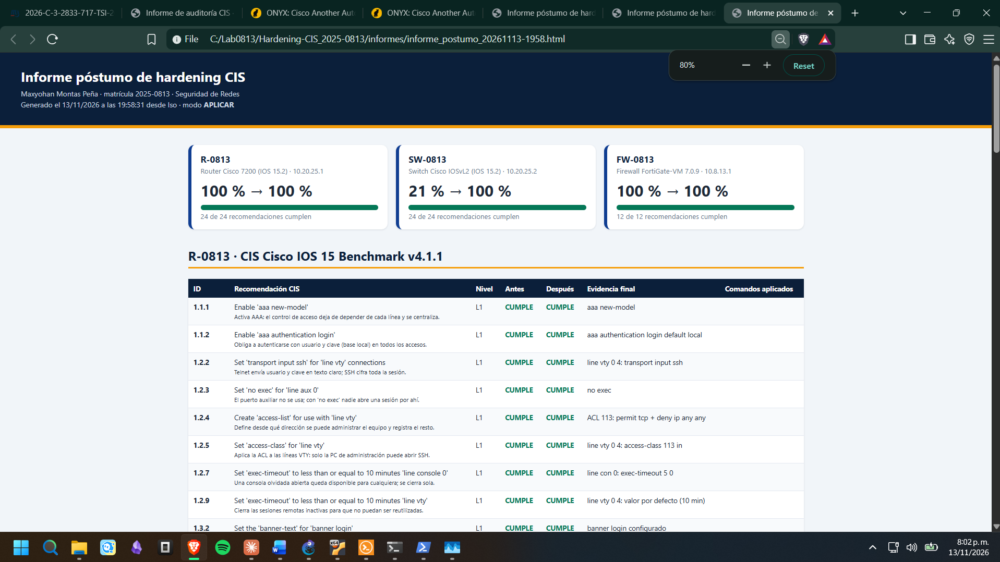

---

## 1. Propósito del laboratorio

Endurecer (*hardening*) una red formada por un **router**, un **switch** y un **firewall** siguiendo el **CIS Benchmark** de cada equipo, y hacerlo de forma medible y repetible:

1. Analizar cada equipo con una herramienta basada en su CIS Benchmark y ver de dónde se parte.
2. Elegir un conjunto de recomendaciones, documentar **cuáles y por qué**, y aplicarlas.
3. Automatizarlo con un script propio que tiene **dos modos**:
   - **auditar**: revisa los equipos y genera un informe **sin aplicar nada**;
   - **aplicar**: aplica las recomendaciones que no se cumplen, vuelve a revisar y genera un **informe póstumo** con el antes y el después.
4. **Probar** en la red que cada recomendación aplicada hace lo que promete.

## 2. Topología y direccionamiento

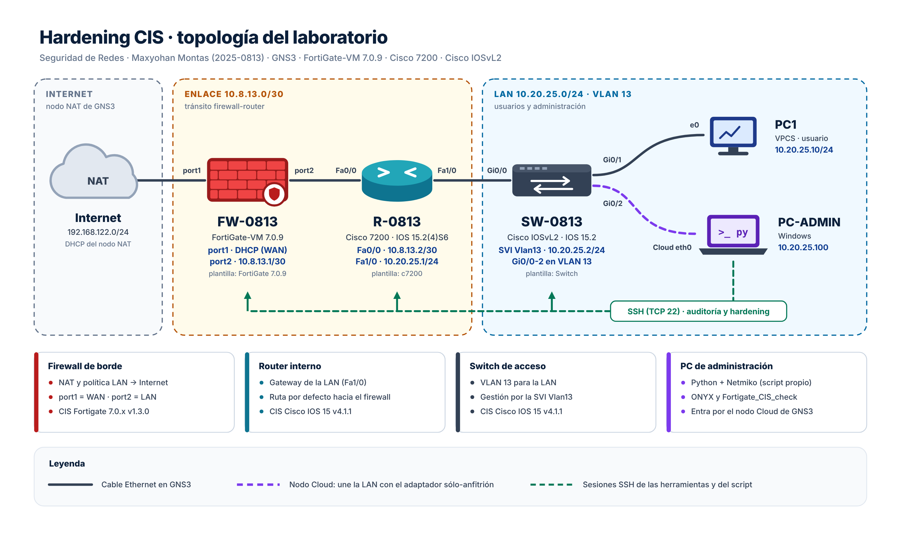

El direccionamiento sale de la matrícula **2025-0813**:
- LAN **`10.20.25.0/24`** (2025);
- VLAN **`13`**;
- enlace firewall-router **`10.8.13.0/30`** (0813).

| Equipo | Plataforma | Interfaz | Dirección | Función |
|---|---|---|---|---|
| **FW-0813** | FortiGate-VM 7.0.9 | port1 (WAN) | DHCP del nodo NAT (192.168.122.0/24) | Salida a Internet con NAT |
| | | port2 (LAN) | 10.8.13.1/30 | Enlace con el router |
| **R-0813** | Cisco 7200 · IOS 15.2(4)S6 | Fa0/0 | 10.8.13.2/30 | Enlace con el firewall |
| | | Fa1/0 | 10.20.25.1/24 | Puerta de enlace de la LAN |
| **SW-0813** | Cisco IOSvL2 · IOS 15.2 | Vlan13 (Gi0/0-2 en VLAN 13) | 10.20.25.2/24 | Gestión del switch |
| **PC1** | VPCS | e0 | 10.20.25.10/24 | Usuario de la LAN |
| **PC-ADMIN** | PC física con Windows | Adaptador *VirtualBox Host-Only*, unido a la LAN por el nodo Cloud de GNS3 | 10.20.25.100/24 | Administración, herramientas y script |

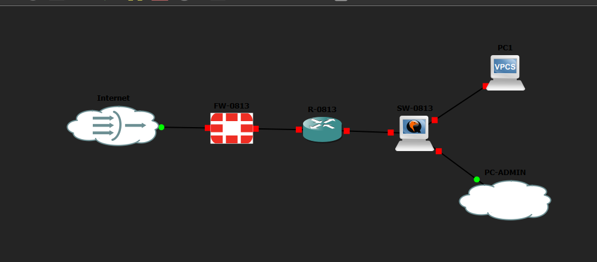

<details>
<summary><b>Preparación del entorno y conectividad (capturas)</b></summary>

| | |
|---|---|
| 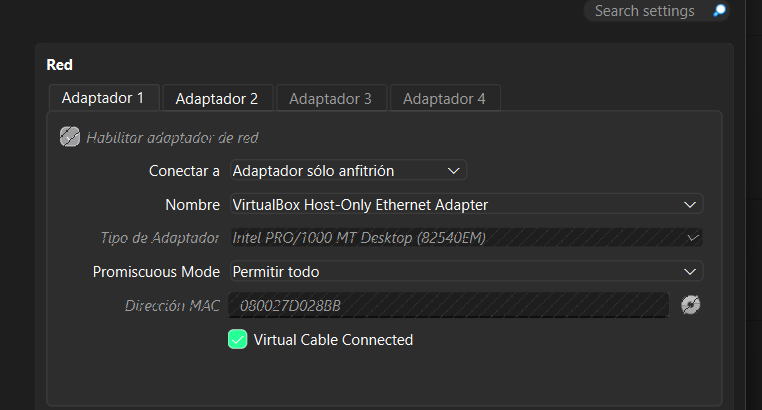 <br> GNS3 VM: adaptador sólo-anfitrión en modo promiscuo «Permitir todo» | 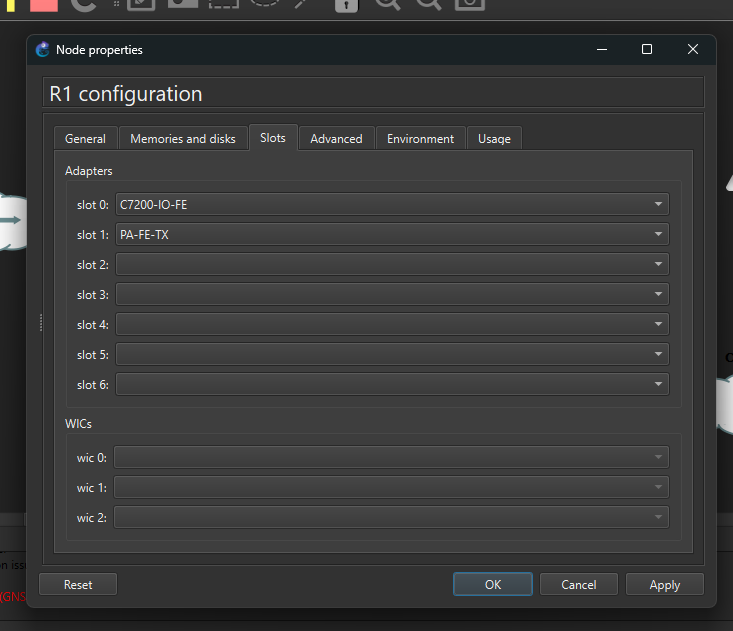 <br> R-0813: slots C7200-IO-FE y PA-FE-TX |
| 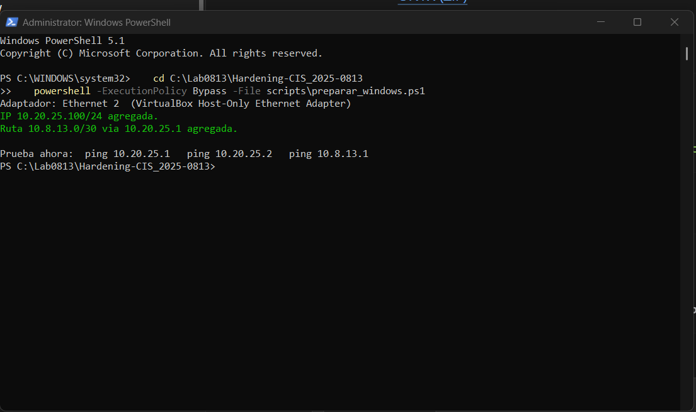 <br> `preparar_windows.ps1`: IP 10.20.25.100/24 y ruta a 10.8.13.0/30 | 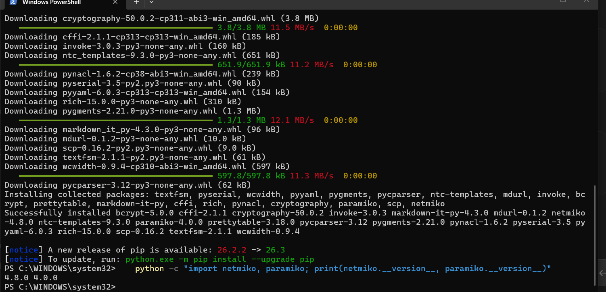 <br> Netmiko 4.8.0 con Paramiko 4.0.0 |
| 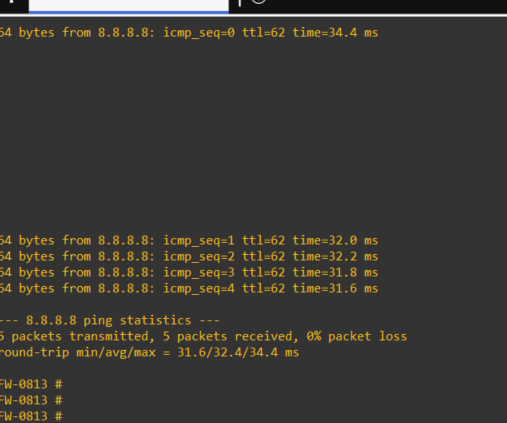 <br> FW-0813 llega a 8.8.8.8 | 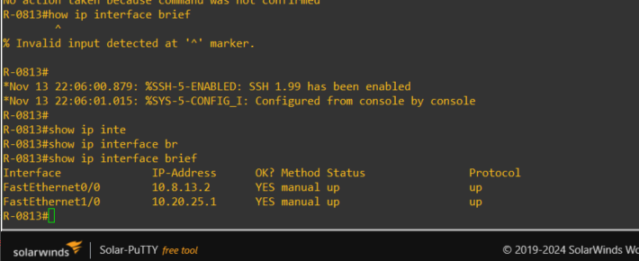 <br> R-0813: Fa0/0 y Fa1/0 arriba |
| 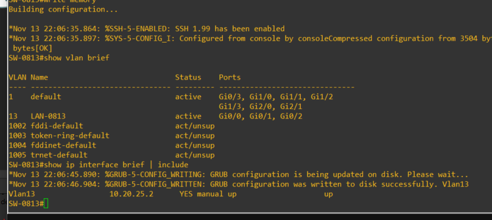 <br> SW-0813: VLAN 13 y SVI Vlan13 | 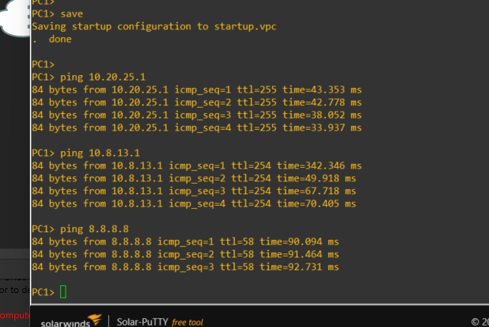 <br> PC1 llega al router, al firewall y a Internet |
| 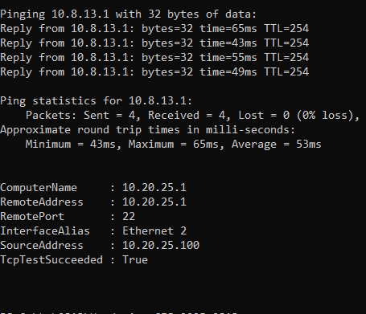 <br> PC-ADMIN llega al firewall y al SSH del router | |

</details>

Las configuraciones iniciales de cada equipo están en [`configs-base/`](configs-base/).

## 3. Herramientas de análisis CIS

| Equipo | Herramienta | Benchmark | Informes |
|---|---|---|---|
| R-0813 y SW-0813 | [ONYX CAAAT](https://github.com/UncleSocks/onyx-caaat-automated-cisco-ios-configuration-assessment-and-auditing-tool) | CIS Cisco IOS 15 Benchmark | [`herramientas/`](herramientas/) (`*_antes.html` y `*_despues.html`) |
| Los tres equipos | Script propio [`cis_hardening_0813.py`](scripts/cis_hardening_0813.py) | CIS Cisco IOS 15 v4.1.1 y CIS Fortigate 7.0.x v1.3.0 | [`informes/`](informes/) |
| FW-0813 | [Fortigate_CIS_check](https://github.com/priyam001/Fortigate_CIS_check) | CIS FortiGate | Trabaja sobre el archivo de configuración; se corrigió para que genere el informe (ver la sección 8) |

**ONYX, antes y después del hardening**

| Equipo | Aprobadas | Fallidas | No aplican |
|---|---|---|---|
| R-0813 antes → después | 14 → **32** | 42 → **24** | 24 |
| SW-0813 antes → después | 16 → **33** | 40 → **23** | 24 |

| Antes | Después |
|---|---|
| 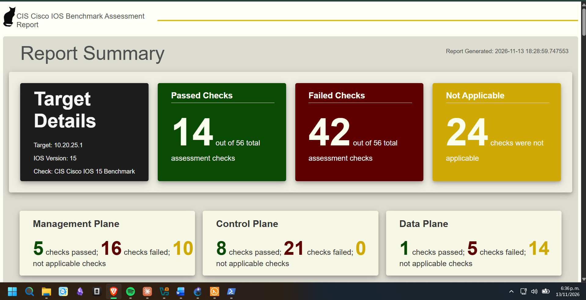 | 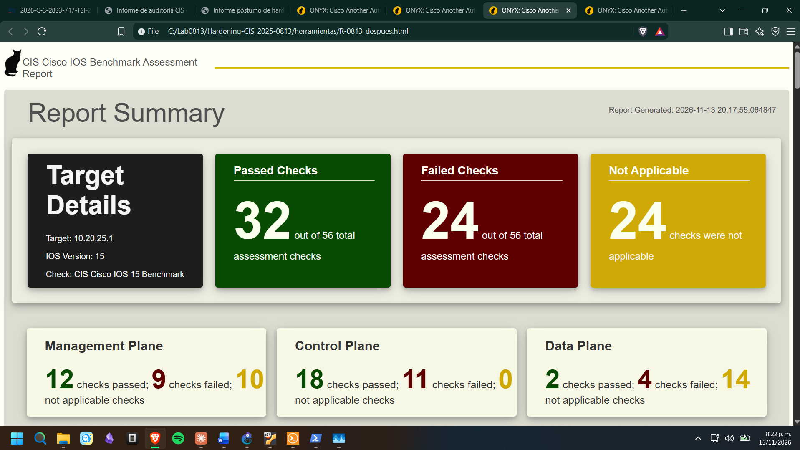 |
| 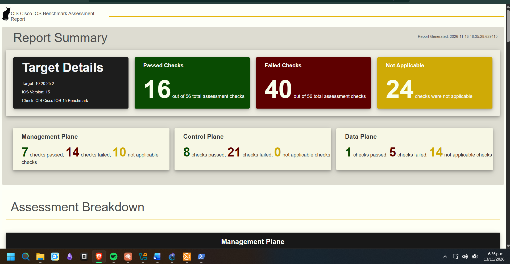 | 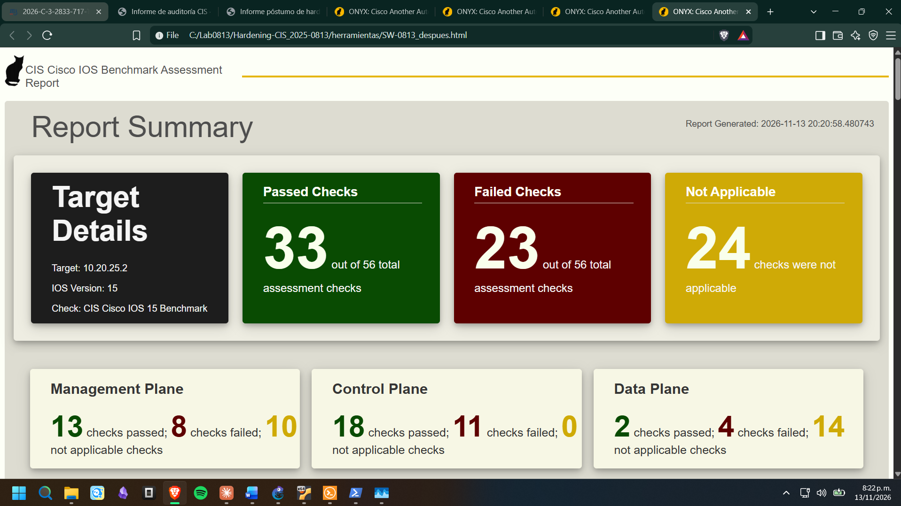 |

## 4. Script de hardening

[`scripts/cis_hardening_0813.py`](scripts/cis_hardening_0813.py) se conecta por SSH a los tres equipos con Netmiko y evalúa **24 recomendaciones en cada Cisco y 12 en el FortiGate**.

```powershell
pip install "netmiko[par4]" prettytable          # Paramiko 4: el IOS 15.2 solo ofrece ssh-rsa
python scripts\cis_hardening_0813.py auditar      # modo 1: informe SIN aplicar ninguna regla
python scripts\cis_hardening_0813.py aplicar      # modo 2: aplica las reglas e informe póstumo
```

Opciones:

| Opción | Uso |
|---|---|
| `--equipos R-0813,FW-0813` | Trabajar solo con algunos equipos |
| `--offline CARPETA` | Auditar archivos de configuración guardados, sin conectarse |
| `--si` | No pedir confirmación antes de aplicar |
| `--debug` | Guardar el diálogo SSH en `logs/`, que no se sube al repositorio |

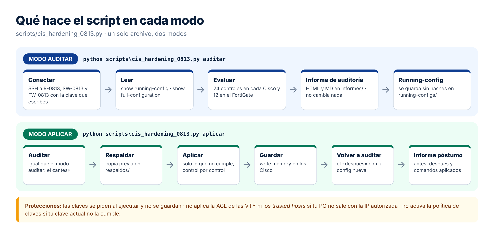

**Protecciones del script**

- Pide el usuario y la clave al ejecutarse: **no hay claves en el repositorio**. Los *running-configs* se guardan sin hashes ni secretos.
- Antes de aplicar guarda un respaldo de cada equipo.
- No aplica la ACL de las VTY (1.2.4/1.2.5) ni los *trusted hosts* del FortiGate (2.4.2) si la PC no sale con la IP de administración 10.20.25.100. Así nunca deja fuera al administrador.
- No activa la política de claves del FortiGate (2.2.1) si la clave actual no la cumple.
- Al guardar en los Cisco responde a la confirmación de NVRAM del c7200 (ver la sección 8).
- Solo cambia lo que no cumple. Lo que ya cumple no se toca.

| Modo auditar: resumen | Modo auditar: informe |
|---|---|
| 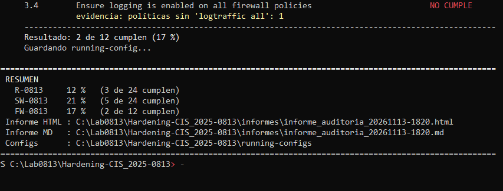 | 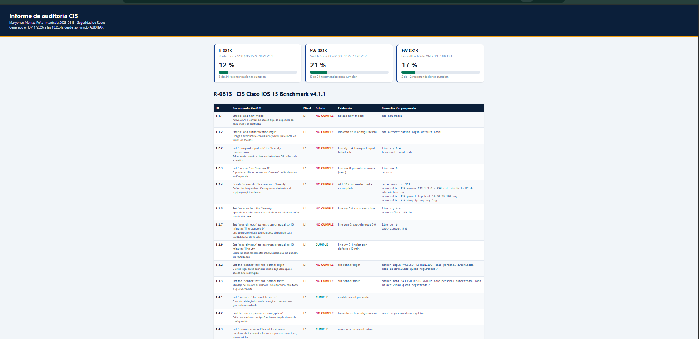 |

| Modo aplicar en el FortiGate | Informe póstumo |
|---|---|
| 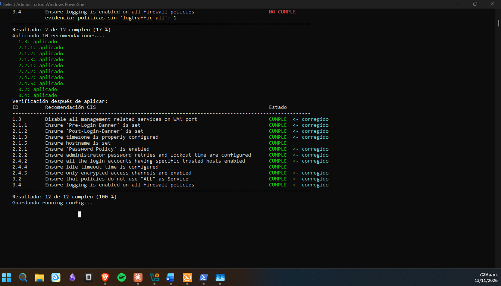 |  |

Informes generados, en HTML y en Markdown, que GitHub muestra directamente:

| Informe | Qué contiene |
|---|---|
| [`informe_auditoria_20261113-1820`](informes/informe_auditoria_20261113-1820.md) | Auditoría inicial de los tres equipos (el «antes») |
| [`informe_postumo_20261113-1910`](informes/informe_postumo_20261113-1910.md) | Primer modo aplicar: SW y FW quedan al 100 %. El router falló al guardar (sección 8). |
| [`informe_postumo_20261113-1958`](informes/informe_postumo_20261113-1958.md) | Estado final con los tres equipos al 100 % |

`informe_postumo_20261113-1938` y `informe_postumo_20261113-1948` son reintentos del router mientras se corregía el problema de la sección 8.

## 5. Recomendaciones CIS aplicadas y por qué

### Router y switch · CIS Cisco IOS 15 Benchmark v4.1.1 (nivel 1)

| ID | Recomendación | Por qué se aplicó | Comando |
|---|---|---|---|
| 1.1.1 | Enable 'aaa new-model' | Centraliza el control de acceso en AAA en lugar de depender de cada línea. | `aaa new-model` |
| 1.1.2 | Enable 'aaa authentication login' | Obliga a autenticarse con usuario y clave (base local) en todos los accesos. | `aaa authentication login default local` |
| 1.2.2 | Set 'transport input ssh' for 'line vty' | Telnet envía usuario y clave en texto claro; SSH cifra la sesión. | `transport input ssh` |
| 1.2.3 | Set 'no exec' for 'line aux 0' | El puerto auxiliar no se usa: nadie puede abrir sesión por ahí. | `line aux 0` / `no exec` |
| 1.2.4 | Create 'access-list' for use with 'line vty' | Define desde qué dirección se administra y registra el resto. | `access-list 113 permit tcp host 10.20.25.100 any` · `deny ip any any log` |
| 1.2.5 | Set 'access-class' for 'line vty' | Solo la PC de administración puede abrir SSH. | `access-class 113 in` |
| 1.2.7 | Set 'exec-timeout' ≤ 10 min en 'line console 0' | Una consola olvidada abierta se cierra sola. | `exec-timeout 5 0` |
| 1.2.9 | Set 'exec-timeout' ≤ 10 min en 'line vty' | Cierra las sesiones remotas inactivas. | Ya cumplía (10 min por defecto) |
| 1.3.2 | Set the 'banner-text' for 'banner login' | Aviso legal antes de iniciar sesión. | `banner login ^…^` |
| 1.3.3 | Set the 'banner-text' for 'banner motd' | Aviso de uso autorizado para todo el que se conecte. | `banner motd ^…^` |
| 1.4.1 | Set 'password' for 'enable secret' | El modo privilegiado queda protegido con un hash. | Ya cumplía (configuración base) |
| 1.4.2 | Enable 'service password-encryption' | Las claves de tipo 0 no se leen a simple vista. | `service password-encryption` |
| 1.4.3 | Set 'username secret' for all local users | Las claves de los usuarios se guardan como hash. | Ya cumplía (configuración base) |
| 2.1.1.1.4 | Set 'seconds' for 'ip ssh timeout' | 60 s para autenticarse: menos ventana para ataques. | `ip ssh time-out 60` |
| 2.1.1.2 | Set version 2 for 'ip ssh version' | SSH versión 1 tiene fallos conocidos. | `ip ssh version 2` |
| 2.1.2 | Set 'no cdp run' | CDP anuncia modelo, versión e IP a cualquier vecino. | `no cdp run` |
| 2.1.3 | Set 'no ip bootp server' | Servicio sin uso: una puerta menos. | `no ip bootp server` |
| 2.1.4 | Set 'no service dhcp' | Estos equipos no reparten direcciones. | `no service dhcp` |
| 2.1.6 | Set 'service tcp-keepalives-in' | Cierra las sesiones entrantes colgadas que ocupan líneas VTY. | `service tcp-keepalives-in` |
| 2.1.7 | Set 'service tcp-keepalives-out' | Cierra las sesiones salientes colgadas. | `service tcp-keepalives-out` |
| 2.1.8 | Set 'no service pad' | PAD (X.25) es un servicio heredado sin uso. | `no service pad` |
| 2.2.2 | Set 'buffer size' for 'logging buffered' | Guarda los eventos en memoria para revisarlos. | `logging buffered 64000` |
| 2.2.3 | Set 'logging console critical' | La consola solo recibe eventos críticos. | `logging console critical` |
| 3.1.1 | Set 'no ip source-route' | El emisor no puede elegir la ruta para saltarse los controles. | `no ip source-route` |

### Firewall · CIS Fortigate 7.0.x Benchmark v1.3.0 (nivel 1)

| ID | Recomendación | Por qué se aplicó | Configuración |
|---|---|---|---|
| 1.3 | Disable all management related services on WAN port | La interfaz de Internet no debe ofrecer administración: ahí llegan los ataques. | `port1`: `unset allowaccess` |
| 2.1.1 | Ensure 'Pre-Login Banner' is set | Aviso legal antes de pedir credenciales. | `set pre-login-banner enable` |
| 2.1.2 | Ensure 'Post-Login-Banner' is set | El administrador acepta el aviso al entrar. | `set post-login-banner enable` |
| 2.1.3 | Ensure timezone is properly configured | Registros con la hora local correcta (GMT-4). | `set timezone 15` |
| 2.1.5 | Ensure hostname is set | Identifica al equipo en registros y respaldos. | Ya cumplía (`FW-0813`) |
| 2.2.1 | Ensure 'Password Policy' is enabled | Claves largas y complejas para los administradores. | `config system password-policy` (8+ caracteres, mayúscula, minúscula, número y símbolo) |
| 2.2.2 | Ensure administrator password retries and lockout time are configured | Tras 3 intentos fallidos el origen queda bloqueado 15 minutos. | `admin-lockout-threshold 3` · `admin-lockout-duration 900` |
| 2.4.2 | Ensure all the login accounts having specific trusted hosts enabled | Aunque roben la clave, solo se entra desde la PC de administración. | `set trusthost1 10.20.25.100 255.255.255.255` |
| 2.4.4 | Ensure idle timeout time is configured | La sesión de administración se cierra tras 5 minutos sin actividad. | Ya cumplía (5 min) |
| 2.4.5 | Ensure only encrypted access channels are enabled | HTTP y Telnet mandan la clave en texto claro. | `port2`: `set allowaccess ping https ssh` |
| 3.2 | Ensure that policies do not use "ALL" as Service | La regla declara qué servicios permite; «ALL» deja pasar cualquier puerto. | `set service "DNS" "HTTP" "HTTPS" "PING" "NTP"` |
| 3.4 | Ensure logging is enabled on all firewall policies | Sin registro de sesiones no se puede reconstruir un incidente. | `set logtraffic all` |

## 6. Pruebas

Cada recomendación aplicada se probó en la red después del hardening, comparando con el estado inicial.

| Recomendación | Prueba | Antes | Después |
|---|---|---|---|
| IOS 1.2.2 · FGT 2.4.5 | `Test-NetConnection` a Telnet (23) del router y del switch, y a HTTP (80) del firewall | Abiertos ([11](evidencias/11_antes_telnet_http_abiertos.png)) | `TcpTestSucceeded : False` en los tres ([24](evidencias/24_despues_telnet_http_cerrados.png)) |
| IOS 1.2.4 · 1.2.5 | PC1 abre TCP 22 al router (`ping 10.20.25.1 -P 6 -p 22`) | Conecta ([12](evidencias/12_antes_pc1_llega_ssh_router.png)) | `RST returned` ([23](evidencias/23_despues_pc1_ssh_rechazado.png)); la ACL 113 cuenta 5 rechazos ([25](evidencias/25_despues_r0813_ssh_banner_acl.png)) |
| IOS 1.3.2 · 1.3.3 | SSH al router desde PC-ADMIN | Sin aviso | Aviso «ACCESO RESTRINGIDO» antes y después de la clave ([25](evidencias/25_despues_r0813_ssh_banner_acl.png)) |
| IOS 2.1.1.1.4 · 2.1.1.2 | `show ip ssh` | Versión 1.99, *timeout* 120 s ([14](evidencias/14_antes_r0813_cdp_ssh.png)) | Versión 2.0, *timeout* 60 s ([25](evidencias/25_despues_r0813_ssh_banner_acl.png)) |
| IOS 2.1.2 | `show cdp` | CDP activo ([14](evidencias/14_antes_r0813_cdp_ssh.png)) | `% CDP is not enabled` ([25](evidencias/25_despues_r0813_ssh_banner_acl.png)) |
| FGT 2.1.1 · 2.1.2 | SSH al firewall | Avisos desactivados (auditoría inicial) | *PRE WARNING* antes de la clave y *POST WARNING* con «Press 'a' to accept» ([26](evidencias/26_despues_fw0813_banners.png)) |
| FGT 2.1.3 · 2.2.2 | `show system global` | Sin zona horaria ni bloqueo de 15 min (auditoría inicial) | `timezone 15` y `admin-lockout-duration 900` ([26](evidencias/26_despues_fw0813_banners.png)) |
| FGT 2.4.2 | `show system admin \| grep trusthost` | Sin *trusted hosts* (auditoría inicial) | `trusthost1 10.20.25.100 255.255.255.255` ([27](evidencias/27_despues_fw0813_trusthost_politica.png)) |
| FGT 1.3 | `show system interface port1` | Con servicios de administración (auditoría inicial) | Sin `allowaccess` ([27](evidencias/27_despues_fw0813_trusthost_politica.png)) |
| FGT 3.2 · 3.4 | `show firewall policy` | `service ALL`, sin `logtraffic all` (auditoría inicial) | Servicios concretos y `logtraffic all` ([27](evidencias/27_despues_fw0813_trusthost_politica.png)) |
| FGT 3.2 | PC1: `ping 1.1.1.1 -P 6 -p 853` (puerto no permitido) | Conecta ([13](evidencias/13_antes_pc1_puerto_853.png)) | `timeout` ([22](evidencias/22_despues_pc1_853_bloqueado.png)) |
| FGT 3.2 | PC1: `ping 8.8.8.8` y `ping 1.1.1.1 -P 6 -p 443` | Responde ([9](evidencias/09_pc1_conectividad.png)) | Sigue respondiendo: la navegación normal no se rompe ([21](evidencias/21_despues_pc1_internet.png)) |

El bloqueo por intentos fallidos (FGT 2.2.2) se verificó en la configuración: el umbral es de 3 intentos, el valor por defecto de FortiOS, y el bloqueo dura 900 s. No se forzó en vivo para no dejar fuera a la PC de administración durante la grabación.

| | |
|---|---|
| 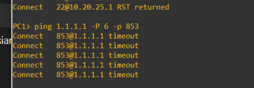 | 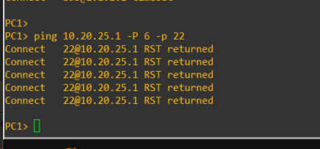 |
| 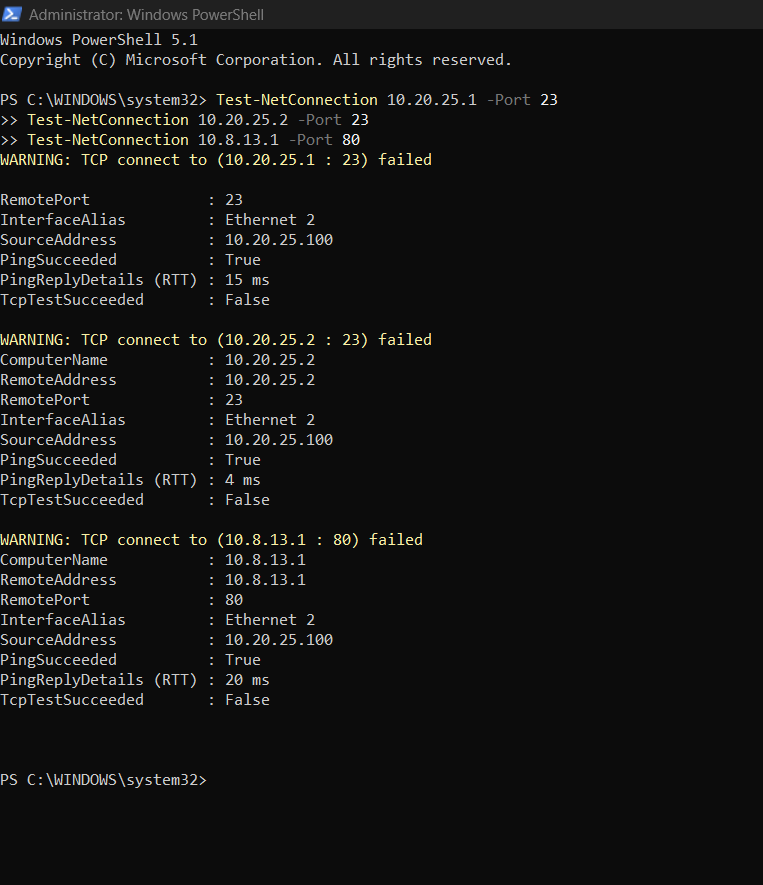 | 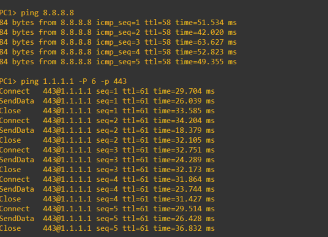 |

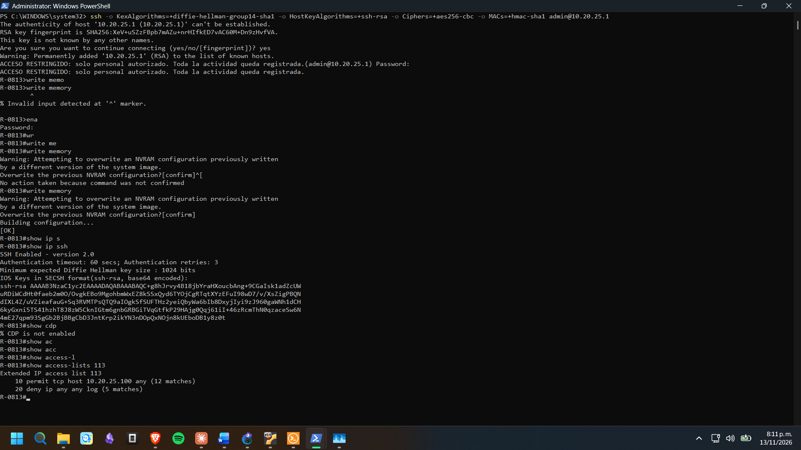

| | |
|---|---|
| 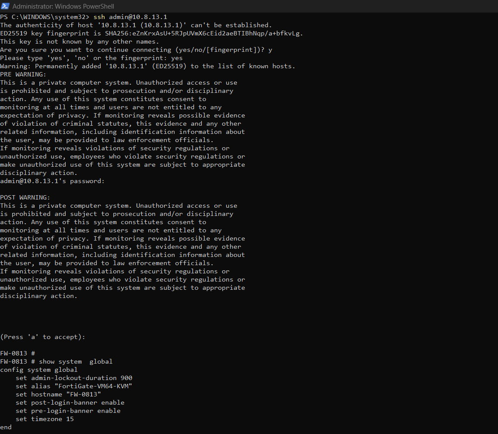 | 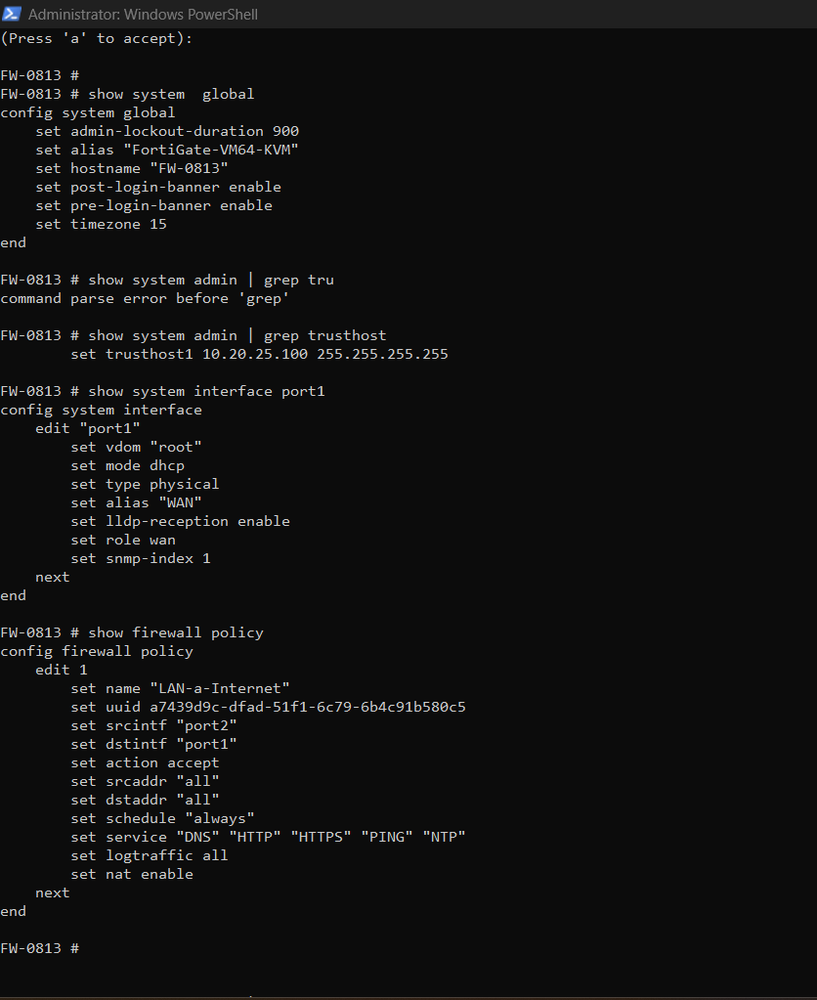 |

## 7. Running-configs

| Archivo | Contenido |
|---|---|
| [`running-configs/R-0813_running-config.txt`](running-configs/R-0813_running-config.txt) | Router después del hardening |
| [`running-configs/SW-0813_running-config.txt`](running-configs/SW-0813_running-config.txt) | Switch después del hardening |
| [`running-configs/FW-0813_running-config.conf`](running-configs/FW-0813_running-config.conf) | FortiGate después del hardening (`show full-configuration`) |
| [`running-configs/antes/`](running-configs/antes/) | Los tres equipos antes del hardening |

Todos se guardan sin hashes, claves cifradas ni llaves privadas (aparecen como `<ELIMINADO>`).

## 8. Problemas encontrados y soluciones

| Problema | Causa | Solución |
|---|---|---|
| El modo aplicar terminó con `ReadTimeout` en el router y el informe mostró 0 % ([31](evidencias/31_problema_informe_readtimeout.png)) | Al guardar, el c7200 de GNS3 pregunta *«Overwrite the previous NVRAM configuration? [confirm]»* ([30](evidencias/30_problema_nvram_confirm.png)) y el script esperaba el *prompt* | El script responde la confirmación al guardar. Si una verificación falla, el informe muestra «sin verificar» en lugar de un 0 % falso. |
| Fortigate_CIS_check dejaba la carpeta de salida vacía y luego fallaba con `'bool' object has no attribute 'value'` ([32](evidencias/32_problema_fortigate_cis_check.png)) | Su repositorio quedó a medio actualizar: el informe HTML usa atributos que el cálculo de puntuación no genera, y las reglas devuelven `True`/`False` en vez de un estado | Parche en [`herramientas/parche_Fortigate_CIS_check/`](herramientas/parche_Fortigate_CIS_check/) |
| ONYX fallaba en el «después» con `TypeError` ([33](evidencias/33_problema_onyx_access_class.png)) | Usa `group['ac']` en lugar de `group('ac')`. Esa línea solo se ejecuta cuando las VTY ya tienen `access-class`, es decir, después del hardening. | Parche en [`herramientas/parche_onyx/`](herramientas/parche_onyx/) |
| La consola del FortiGate se llenó de errores `EXT3-fs error (device vdb1)` ([34](evidencias/34_problema_fw_disco_logs.png)) | El disco de logs de la VM quedó dañado por un cierre forzado del nodo. Se notó al activar el registro de tráfico (3.4). | `execute formatlogdisk` (la configuración está en otro disco y no se pierde) |
| El SSH de Windows no conectaba al router: *no matching MAC found* ([35](evidencias/35_problema_ssh_mac_windows.png)) | IOS 15.2 solo ofrece algoritmos antiguos (ssh-rsa, DH group14-sha1, hmac-sha1) | `ssh -o KexAlgorithms=+diffie-hellman-group14-sha1 -o HostKeyAlgorithms=+ssh-rsa -o Ciphers=+aes256-cbc -o MACs=+hmac-sha1 admin@10.20.25.1` |
| Paramiko 5 no conecta al IOS 15.2 | Paramiko 5 quitó ssh-rsa con SHA-1 | `pip install "netmiko[par4]"`: Netmiko 4.8.0 con Paramiko 4.0.0 |
| Tras reiniciar nodos en GNS3, el switch volvió a su configuración inicial | Al arrancar, el nodo cargó una configuración anterior | El script lo detectó (21 %) y lo volvió a endurecer y guardar. Desde ese momento no se reiniciaron nodos sin guardar el proyecto. |
| La política de claves del FortiGate (2.2.1) no se debía aplicar con la clave inicial | La clave inicial no cumplía esa política | Se cambió la clave del administrador por una que cumple la política antes de aplicar 2.2.1 |

## 9. Contenido del repositorio

```
├── README.md                      Esta página (video al inicio)
├── docs/                          Documentación completa (PDF y Word)
├── diagramas/                     Topología y flujo del script
├── evidencias/                    Capturas numeradas de cada paso y prueba
├── configs-base/                  Configuración inicial de cada equipo
├── scripts/
│   ├── cis_hardening_0813.py      Auditoría y hardening automatizado (dos modos)
│   ├── preparar_windows.ps1       IP y ruta de la PC de administración
│   └── limpiar_windows.ps1        Deshace lo anterior
├── herramientas/                  Informes de ONYX (antes y después) y parches de las herramientas
├── informes/                      Informes del script (auditoría y póstumos, en HTML y Markdown)
└── running-configs/               Running-config final de los tres equipos (y antes/ con el inicial)
```

## 10. Referencias

- CIS Cisco IOS 15 Benchmark v4.1.1 y CIS Fortigate 7.0.x Benchmark v1.3.0 — https://www.cisecurity.org/cis-benchmarks
- ONYX CAAAT — https://github.com/UncleSocks/onyx-caaat-automated-cisco-ios-configuration-assessment-and-auditing-tool
- Fortigate_CIS_check — https://github.com/priyam001/Fortigate_CIS_check
- Netmiko — https://github.com/ktbyers/netmiko
- GNS3 — https://docs.gns3.com/
